# Packform Email Automation

> An n8n-based automation system that reads every incoming Packform email, classifies it into one of 11 business events, pulls live order and supplier data from the Packform API, applies pricing and margin rules, and routes the result to the right person as a Telegram report, an Airtable task, or a silent log entry.


---

## Table of Contents

- [Screenshots](#screenshots)
- [What I Built](#what-i-built)
- [How It Works](#how-it-works)
- [The 11 Workflow Paths](#the-11-workflow-paths)
- [Tool Stack](#tool-stack)
- [Data Layer](#data-layer)
- [Design Principles and Safety Controls](#design-principles-and-safety-controls)
- [Intentionally Out of Scope](#intentionally-out-of-scope)

---

## Screenshots

<p align="center">
  <a href="#1-email-classifier-parent-workflow">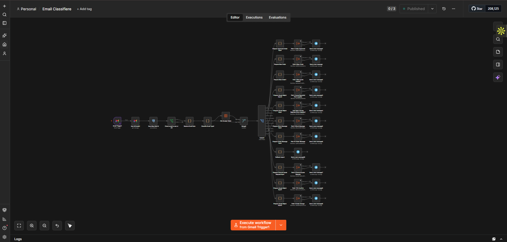</a>
  <a href="#2-path-1--new-quote-request">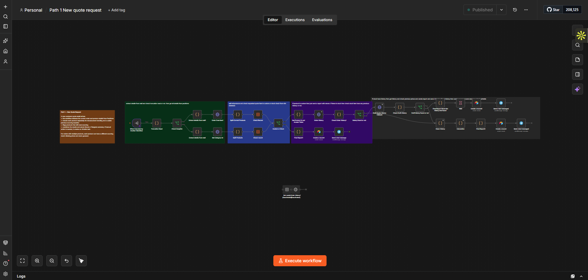</a>
  <a href="#3-path-2--quote-received-from-supplier">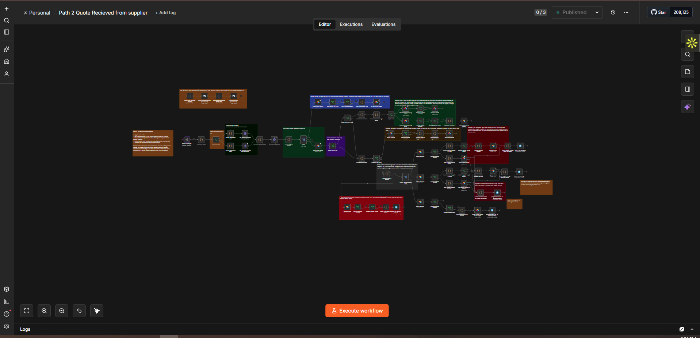</a>
  <a href="#4-path-3--quote-requested">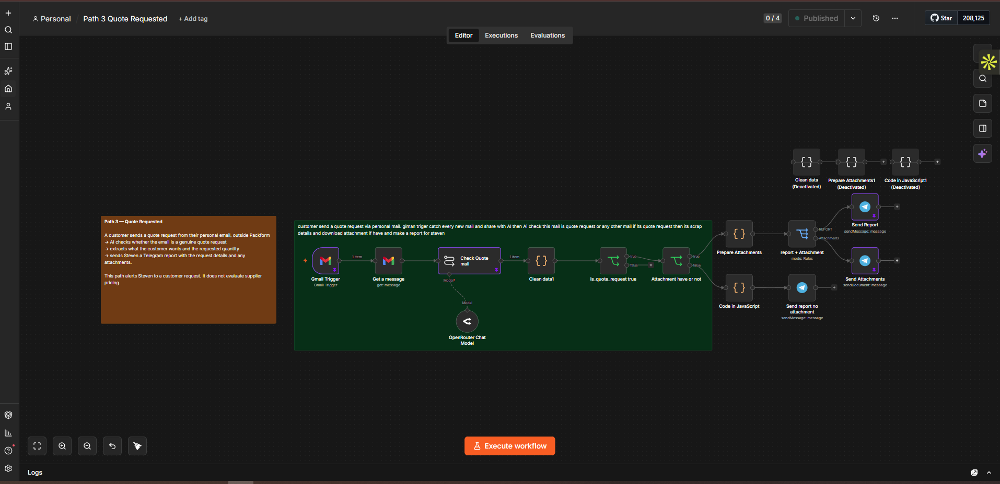</a>
  <a href="#5-path-4--order-approved">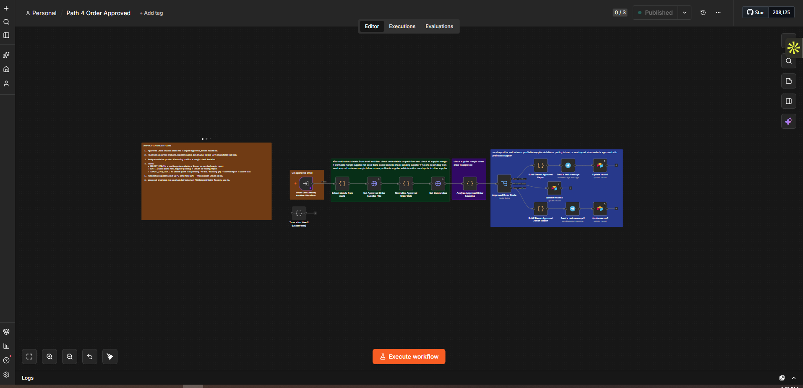</a>
</p>
<p align="center">
  <a href="#6-path-5--quote-rejected-from-supplier">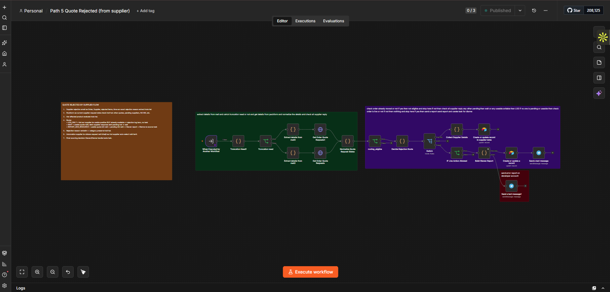</a>
  <a href="#7-path-6--new-order">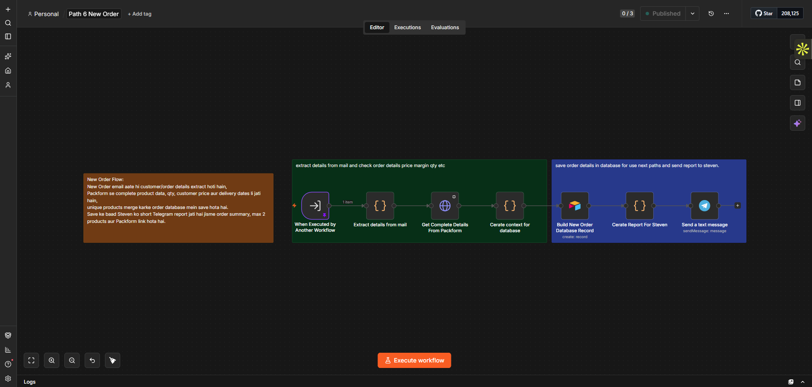</a>
  <a href="#8-path-7--po-confirmed">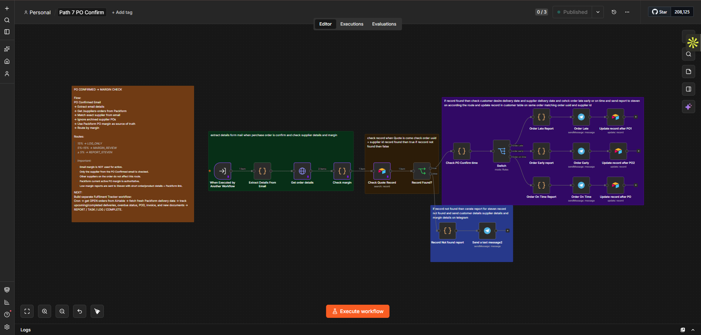</a>
  <a href="#9-path-8--order-change">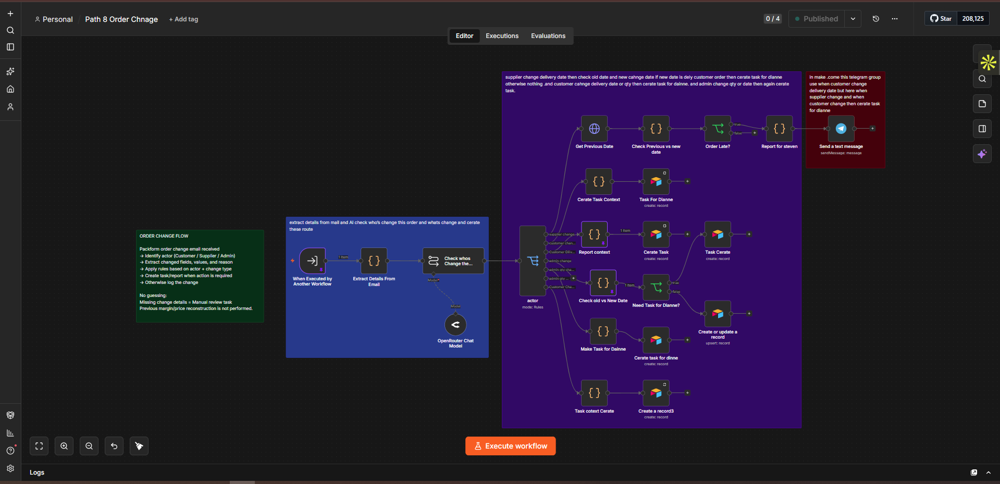</a>
  <a href="#10-path-9--cancelled-quote-request">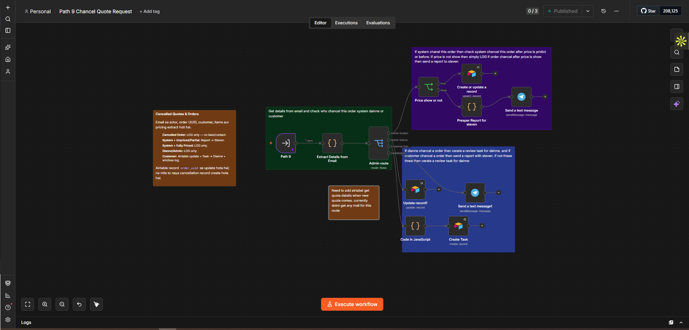</a>
</p>
<p align="center">
  <a href="#11-path-10--order-message">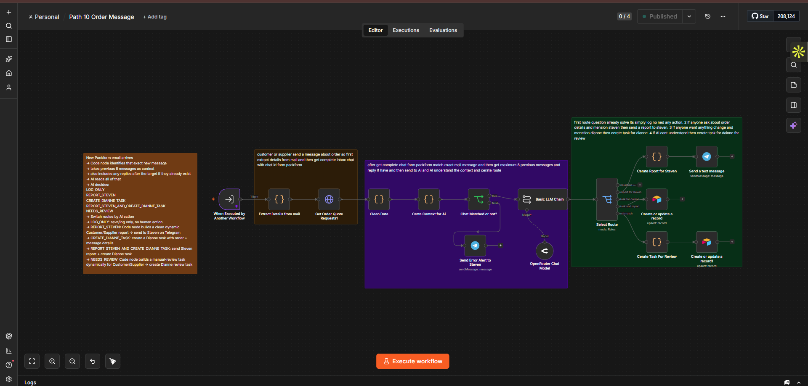</a>
  <a href="#12-path-11--access-token-save-and-product-catalog-sync">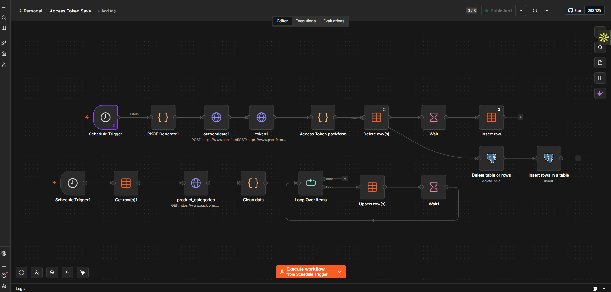</a>
</p>
<p align="center"><sub>Click any thumbnail to jump to the full-size view.</sub></p>

### 1. Email Classifier (parent workflow)


The shared entry point. A Gmail trigger fires on every new Packform email, the message is fetched and de-duplicated against previously seen mail, the subject is matched against verified patterns, a fresh Packform access token is attached, and a Switch node hands the email to exactly one of the 11 sub-workflows. Unmatched emails fall into a fallback report instead of triggering any business action.

### 2. Path 1 – New Quote Request


A customer asks Packform to price one or more products. Every product is evaluated separately: Custom products go straight to a "price from scratch" report, Stock products are checked against accepted order history and then draft quote history, and the results are merged into a single Telegram report for Steven. The quote is also saved to Airtable.

### 3. Path 2 – Quote Received from Supplier


The most complex path. A supplier reply is parsed (with a Packform lookup when the email is truncated), No Bid is separated from a usable quote, the correct pricing mode is selected (customer target price, current sell price, or a suggested 30% margin), the margin band is calculated, and moved-order and pending-supplier checks decide whether to log, wait, create a Dianne task, or escalate to Steven.

### 4. Path 3 – Quote Requested


Handles quote requests that arrive from a customer's personal email rather than through Packform. An LLM step first verifies the email is a genuine quote request, the available details are extracted, and Steven receives a report with any attachments the customer included.

### 5. Path 4 – Order Approved


When a customer approves an order, the workflow pulls the approved order, all supplier purchase orders, and outstanding quote requests from Packform, compares every supplier buy price against the customer sell price, and routes to a supplier-review report, a wait state, or a sourcing-action report paired with a Dianne task. The original approval timestamp is preserved in Airtable for later fulfilment timing.

### 6. Path 5 – Quote Rejected from Supplier


A supplier declines a quote request. The workflow extracts the supplier, rejected items, and rejection reason (with a truncation branch when the email is cut off), retrieves the live quote-request state for every affected product, and decides whether the rejection only needs logging, should wait for another pending supplier, or needs a Steven report plus a Dianne re-sourcing task. A separate error branch reports failures to the developer's Telegram.

### 7. Path 6 – New Order


A customer places a direct order with product, quantity, and price already stated. The workflow enriches the email with the complete Packform order, builds a normalised database record (with the customer price saved as the target price for later supplier comparison in Path 2), and sends Steven a concise NEW ORDER alert.

### 8. Path 7 – PO Confirmed


A supplier confirms a purchase order. The workflow matches the exact supplier against active Packform purchase orders, recalculates the authoritative margin, then checks the saved quote record. If found, it compares the customer's desired delivery date with the supplier's date and sends an Order Late, Order Early, or Order On Time report, updating the Airtable record each time. If no record exists, Steven receives a record-not-found report with the supplier and margin details.

### 9. Path 8 – Order Change


An existing order is modified. An LLM step identifies the actor (Customer, Supplier, or Admin) and the type of change, then a Switch node routes through seven verified branches. Supplier delivery-date changes are compared against the previous customer commitment and only a late result reaches Steven. Customer and Admin quantity or date changes create Dianne review tasks. Unclear changes fall to a manual-review task rather than a guess.

### 10. Path 9 – Cancelled Quote Request


System, Admin, and Customer cancellations share the same email subject, so the actor is parsed from the body. System cancellations are checked for whether pricing was shown: priced quotes are logged, unpriced ones go to Steven as a process-failure report. Admin cancellations are logged quietly. Customer cancellations update the Airtable record, create a Dianne follow-up task, and log the win/loss entry. System and Admin events never trigger customer contact.

### 11. Path 10 – Order Message


A customer or supplier sends a message about an existing order. Instead of classifying from one sentence, the workflow uses the chat ID to pull the complete Packform inbox conversation, matches the exact target message, and builds a context window of up to eight previous messages plus any replies that already exist. An LLM chain then picks one of five routes: log only, Steven report, Dianne task, both, or a manual-review task when the message cannot be matched reliably. A resolved conversation is never turned into new work.

### 12. Path 11 – Access Token Save and Product Catalog Sync


Two scheduled support workflows. The upper one runs every 10 hours: it generates a PKCE challenge, authenticates with Packform, cleans the new access token, deletes the old row, waits, and inserts the fresh token that every other workflow reads. The lower one runs hourly: it fetches Packform product categories, cleans the response, and loops through the records to upsert each one into the categories data table that Path 1 uses for Custom-vs-Stock classification.

---

## What I Built

Packform is a packaging distribution platform. The business receives a steady stream of transactional emails from it: new quote requests, supplier replies, order approvals, purchase-order confirmations, order changes, cancellations, and inbox messages. Before this project, every one of those emails had to be read by a person, cross-checked against the Packform web app, priced by hand, and turned into either a decision for the owner or a task for the operations lead.

I built a complete event-driven automation layer on top of that email stream:

- **One shared classifier** that reads every incoming Packform email and routes it to the correct workflow using first-match-wins subject rules.
- **Eleven dedicated workflow paths**, each owning the business logic for one event type, with its own extraction, Packform API lookups, decision rules, and output.
- **Two scheduled support workflows** that keep the Packform access token fresh every 10 hours and sync the product category catalog every hour.
- **An Airtable operational layer** that stores order and pricing context across events and collects every automation-generated task in one queue with a filtered interface for the operations lead.
- **Telegram reporting** so the owner receives short, decision-ready reports instead of raw emails.

The system is deliberately **advisory, not autonomous**. It compares, calculates, flags, and reports. It never selects a supplier, sends a purchase order, sets a customer price, or contacts a customer on its own. Every irreversible commercial decision stays with a human.

---

## How It Works

```
Gmail inbox
    │
    ▼
┌───────────────────────────────────────────────┐
│  Email Classifier (parent workflow)           │
│  1. Gmail trigger on new Packform email       │
│  2. Fetch full message, drop already-seen     │
│  3. Match subject against verified patterns   │
│  4. Attach fresh Packform access token        │
│  5. Switch → one of 11 sub-workflows          │
└───────────────────────────────────────────────┘
    │
    ▼
┌───────────────────────────────────────────────┐
│  Sub-workflow (one per event type)            │
│  • Extract fields from the email body         │
│  • Detect truncation → fetch missing data     │
│  • Call Packform API for live order state     │
│  • Normalise into a single decision record    │
│  • Apply business rules / LLM classification  │
│  • Route via Switch node                      │
└───────────────────────────────────────────────┘
    │
    ├──► Telegram report to Steven (owner)
    ├──► Airtable task for Dianne (operations)
    ├──► Airtable record create / update (log)
    └──► Wait / No action
```

Every path follows the same shape, which keeps the system predictable:

1. **Extract** the identifiers (order UUID, order number, customer, supplier, products, quantities, prices, timestamps) from the email.
2. **Verify** against Packform. The email is treated as a signal, not as the source of truth. Margins written in an email are never used for routing; the live Packform purchase-order margin is.
3. **Normalise** into one record so the decision step has a stable shape regardless of how the email was formatted.
4. **Decide** using explicit rules (margin bands, moved-order checks, pending-supplier checks, date comparisons) or an LLM step where the input is genuinely unstructured (actor detection, intent detection, genuine-request detection).
5. **Route** to exactly one output. Duplicate and timing controls prevent a second task or report from being created once an order has already progressed.

---

## The 11 Workflow Paths

| # | Path | Trigger | Core logic | Outputs |
|---|------|---------|-----------|---------|
| 1 | **New Quote Request** | Customer asks for a price | Each product classified Custom vs Stock using the synced category catalog. Stock items checked against accepted order history, then draft quote history. | Steven report (3 variants) + Airtable record |
| 2 | **Quote Received from Supplier** | Supplier replies with price or No Bid | Pricing mode C (customer target) or B (current sell price) or suggested 30% margin. Margin bands: ≥21% log, 5–21% continue with controls, <5% hard stop. | Log / Wait / No action / Dianne task / Steven report |
| 3 | **Quote Requested** | Customer emails from personal address | LLM confirms it is a genuine quote request, extracts product and quantity details. | Steven report with or without attachments |
| 4 | **Order Approved** | Customer approves order | Compare every supplier buy price vs customer sell price; check pending responses. | REPORT_STEVEN / WAIT / REPORT_AND_TASK |
| 5 | **Quote Rejected from Supplier** | Supplier rejects quote request | Per-product sourcing state: has another supplier quoted, is one still pending, has the order moved. Rejection reason preserved verbatim. | LOG_ONLY / WAIT / REPORT_AND_TASK |
| 6 | **New Order** | Customer places a direct order | Full order enriched from Packform, duplicates merged, customer price stored as target price for later supplier comparison. | Airtable record + Steven Telegram alert |
| 7 | **PO Confirmed** | Supplier confirms purchase order | Match exact supplier, ignore archived POs, use live Packform PO margin. >15% log, 5–15% margin review, ≤5% low-margin report. | Log / Margin review / Steven report |
| 8 | **Order Change** | Existing order modified | LLM identifies actor (Customer / Supplier / Admin) and change type. Seven verified routes with date-window comparison for delivery changes. | Steven report / Dianne task / Log |
| 9 | **Cancelled Quote Request** | Quote cancelled | Actor parsed from email body (System / Admin / Customer) because subject is identical. Item-level pricing check decides expiry vs genuine loss. | Steven report / Dianne task + win-loss entry / Log |
| 10 | **Order Message** | Customer or supplier sends message | Fetches full Packform inbox thread, matches exact target message, builds up to 8 prior messages plus any existing replies as LLM context. | LOG_ONLY / REPORT_STEVEN / CREATE_DIANNE_TASK / REPORT_AND_TASK / NEEDS_REVIEW |
| 11 | **Access Token Save** | Schedule every 10 hours | PKCE authentication with Packform, delete old token row, insert new token for all other workflows to read. | Shared token in n8n data table |

**Supporting workflow – Product Catalog Sync.** Runs hourly, pulls Packform product categories, cleans the response, and upserts each row (category ID, name, code, hierarchy level, custom flag, archived flag, service flag) into an n8n data table. Path 1 reads this table to decide whether a requested product is Custom or Stock.

---

## Tool Stack

| Layer | Tool | Role in the project |
|-------|------|---------------------|
| Orchestration | **n8n** (self-hosted) | All 11 paths, the classifier, and both scheduled jobs are n8n workflows. Sub-workflows are invoked with the "Execute Workflow" pattern so the classifier stays thin. |
| Trigger | **Gmail** | Gmail Trigger node on the Packform notification inbox; Get Message node pulls the full body and attachments. |
| Source of truth | **Packform API** | HTTP Request nodes for orders, supplier purchase orders, quote requests, inbox conversations, and product categories. Authenticated with a PKCE flow handled by Path 11. |
| AI | **OpenRouter** (Chat Model nodes) | Used only where input is unstructured: genuine-request detection (Path 3), actor and change-type classification (Path 8), message intent (Path 10). All structured decisions use plain rules. |
| Logic | **n8n Code nodes (JavaScript)** | Extraction, truncation detection, normalisation, margin maths, date comparison, report text generation. |
| Routing | **n8n Switch / If nodes** | Rule-based routing so every email ends in exactly one outcome. |
| Operational records | **Airtable** | `Customers` table (order and pricing context keyed by `order_uuid`), `Task` table (every Dianne task from every path), and the `All Tasks List` interface. |
| Reference data | **n8n Data Tables** | Product category catalog and the shared Packform access token. |
| Notifications | **Telegram** | Owner receives short, formatted decision reports. Documents are sent with `sendDocument` when attachments exist. |

---

## Data Layer

### Airtable `Customers` table

Created on New Quote Request or New Order using `order_uuid` as the stable key. Stores quote number, customer, order state, customer sell total, landed total, margin dollars, and margin percent. Later events (supplier quote, approval, cancellation) **update the same row** so the order history stays connected instead of being scattered across disconnected records. Path 2 reads this row to find the customer's target price or existing sell price when choosing its pricing mode.

### Airtable `Task` table

Every Dianne task from every path lands here with `order_uuid`, task ID, assignee, customer, supplier, customer reference, task type, status, task text, and priority. One table means one queue; there are no per-workflow task silos.

### `All Tasks List` interface

An Airtable interface over the Task table. It is a view, not a copy, so completing a task in the interface updates the underlying record.

### n8n Data Tables

- `categories` – hourly-synced Packform product catalog used for Custom vs Stock classification.
- Access token table – single row, replaced every 10 hours.

---

## Design Principles and Safety Controls

- **First-match-wins routing.** Specific subject patterns are evaluated before general ones so an email can never land in the wrong path.
- **Email is a signal, Packform is the truth.** Every path re-fetches live state before deciding. Margins in email text are never trusted for routing.
- **Truncation handling.** Long emails are detected as truncated and the missing data is retrieved from Packform instead of being guessed.
- **Moved-order check.** If the order has already progressed past the stage the email refers to, the event is logged and no new task or report is created.
- **Pending-supplier check.** The system waits for outstanding supplier responses before escalating, so the owner is not asked to act on incomplete information.
- **Stable keys.** `order_uuid` is used across Airtable and n8n so updates always hit the correct record.
- **No invented data.** Missing fields stay missing in reports. Where an LLM cannot classify reliably, the path falls to a `NEEDS_REVIEW` or manual-review task rather than guessing.
- **Human decision boundary.** The automation never auto-selects a supplier, sends a PO, sets a customer price, blocks a customer, or contacts a customer directly.
- **Actor-aware cancellations.** System and Admin cancellations never trigger customer contact, even though the email boilerplate asks for it.

---

## Intentionally Out of Scope

Three paths were designed, reviewed with the business owner, and deliberately excluded from this version:

- **Proactive accounts-receivable follow-up** – already handled manually; the automation sends no collection messages and makes no credit decisions.
- **Block-list / credit-status registry** – credit holds remain a human decision; any future version would start as a read-only flag.
- **Ticket request tracking** – the system is email-triggered and cannot know a ticket changed unless an email arrives. A notification-only version can be added later.

A separate **Fulfilment Tracker** workflow (scheduled scan of open orders for delivery, PO, invoice, and proof-of-delivery status) is planned as the next phase.

---

## Author

**Abuzar Saleem** – Full-Stack AI Developer specialising in AI automation, Python, and web scraping.
[GitHub](https://github.com/abuzar561) · [LinkedIn](https://www.linkedin.com/in/abuzar-saleem-907345386)
